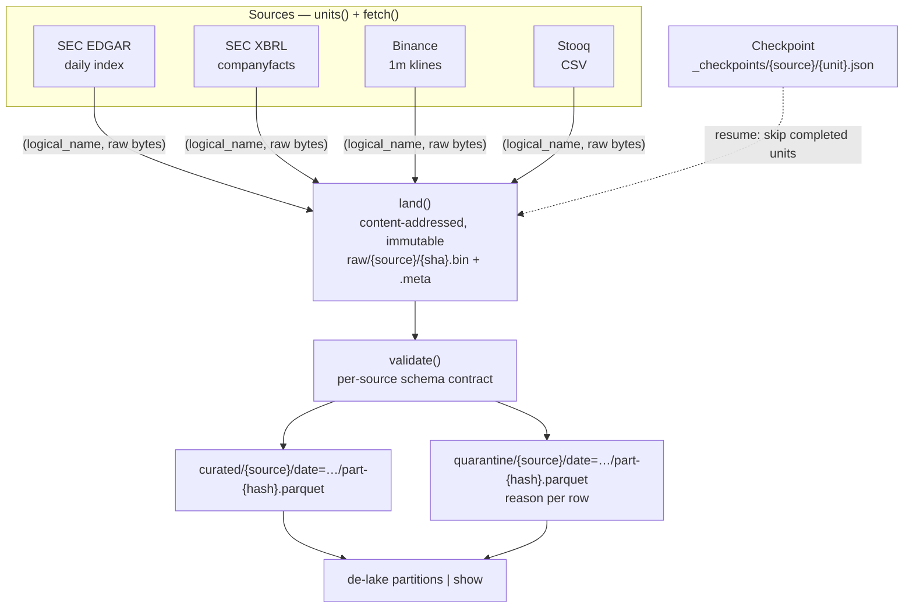

# Market Data Lake

A resumable, idempotent ingestion pipeline that lands SEC filings, XBRL company
facts, Binance OHLCV and Stooq daily OHLCV into a partitioned Parquet lake — with
**no cloud account, no API key and no credit card.**

---

## Introduction & goals

Real market data from three upstreams that share nothing: SEC's JSON filing
envelopes, XBRL's nested fact graph, and Binance's positional kline arrays. They
are fetched, landed immutably, validated against per-source schema contracts, and
written into a partitioned Parquet lake — and re-running any of it changes
nothing.

**Goal 1: Re-running the pipeline over unchanged data writes zero new bytes.**
*How I know it worked:* a second run over the same date range reports
`units: 0, landed: 0`, and the lake is byte-identical before and after.

**Goal 2: A hard kill mid-backfill resumes without corrupting or duplicating.**
*How I know it worked:* `SIGKILL` mid-range, re-run, and the final row count
matches an uninterrupted run exactly.

**Goal 3: No row is ever silently dropped.**
*How I know it worked:* every row failing its contract lands in `quarantine/`
with a `reason` naming the offending column, and the count is reported per run.

> Zero cost was a hard constraint, not a nice-to-have. Docker Hub was unreachable
> and Cloudflare R2 requires a payment method to enable, so the lake is built on
> a storage abstraction with a local filesystem default — see
> [ADR-0001](docs/adr/0001-pluggable-storage-backends.md). Pointing it at R2 later
> is four environment variables and zero code changes.

## Architecture



Two properties fall out of the naming rather than out of bookkeeping:

- **Landing is content-addressed.** The key is the sha256 of the payload, so
  landing the same bytes twice is a no-op (`WriteResult.created == False`).
- **Curation filenames are content hashes too.** Re-curating unchanged data
  rewrites the identical key.

That is why idempotency needs no manifest to keep in sync — there is nothing to
get out of sync.

## Quickstart

```bash
uv sync
uv run pytest -q          # 147 tests, no network, no credentials
uv run de-lake partitions # browse the lake
uv run de-lake show curated/stooq/date=2026-01-05/part-<hash>.parquet
```

Run the Airflow DAG:

```bash
uv run airflow standalone     # http://localhost:8080 — user: airflow / airflow
```

Point at S3-compatible storage (Cloudflare R2, MinIO, Garage, AWS S3):

```bash
export DE_LAKE_S3_BUCKET=de-lake
export DE_LAKE_S3_ENDPOINT=                 # omit for AWS S3
export DE_LAKE_S3_ACCESS_KEY=...
export DE_LAKE_S3_SECRET_KEY=...
```

No code changes. No new imports.

## The data set

| Source | Shape | Volume | Credentials |
| --- | --- | --- | --- |
| SEC EDGAR daily index | Pipe-delimited text, one JSON doc per filing | ~1–2k filings/day, ~20M since 1994 | none — a User-Agent email |
| SEC XBRL company facts | Nested fact graph; one row per (taxonomy, tag, unit) | ~630M facts across issuers | none |
| Binance 1m klines | Positional arrays, 13 unnamed fields | 1,440 candles/symbol/day | none |
| Stooq daily OHLCV | Flat CSV with a header | Decades per ticker | none |

Three genuinely different wire formats on purpose. A pipeline that only ever
sees JSON has tested one assumption four times.

## Used tools

| Layer | Choice |
| --- | --- |
| Language | Python 3.14 |
| Data | Polars, PyArrow |
| Storage | Parquet over an `ObjectStore` protocol; filesystem default, S3-compatible optional |
| Orchestration | Apache Airflow 3.3 |
| Contracts | Hand-written per-source schemas (no framework) |
| Tests | pytest + moto |

## What breaks

Known limitations, stated rather than discovered later:

- **Stooq has no per-date endpoint.** It serves a ticker's whole history as one
  file, so a "unit" of work is a date but the payload is not scoped to it. The
  same file therefore lands repeatedly under different checkpoints — harmless,
  because landing is content-addressed, but it means `landed: 0` on a re-run is
  not evidence of *no network traffic*.
- **XBRL unit granularity is not time-bounded.** `units()` returns CIKs, because
  `companyfacts` has no date range. One large issuer is therefore one
  unresumable unit of work.
- **Partition skew is unmeasured.** SEC filing counts per day vary by orders of
  magnitude. [ADR-0003](docs/adr/0003-partition-by-source-and-date.md) names the
  thresholds at which date partitioning should become month-level or bucketed,
  and what compaction to do first.
- **A successful-but-empty fetch is indistinguishable from a parse failure.**
  A day with no filings and a session that returned nothing useful both record as
  a completed unit. Transient failures are prevented from looking like this by
  raising `RetryableSourceError` on 429/5xx, but a malformed 200 body would land
  raw and be caught at curation rather than here.
- **S3 is tested against `moto`, not a live endpoint.** The boundary is the same
  `boto3` API, but a live-endpoint edge case remains untested.

## Design decisions

Each is a written ADR, because "why this and not the obvious alternative" is the
part worth reading in an interview.

| ADR | Decision |
| --- | --- |
| [0001](docs/adr/0001-pluggable-storage-backends.md) | Pluggable `ObjectStore`; filesystem default, S3 by config |
| [0002](docs/adr/0002-parquet-over-a-warehouse-for-the-lake.md) | Lake is partitioned Parquet; Postgres arrives in P2 |
| [0003](docs/adr/0003-partition-by-source-and-date.md) | Partition by source and date; filenames are content hashes |

## Layout

```
src/de_lake/
  storage/       ObjectStore protocol, FilesystemStore, S3Store
  contracts.py   per-source schemas; validate() → ok + quarantine + reasons
  landing.py     content-addressed immutable capture
  curate.py      partition, validate, write mart before quarantine
  checkpoint.py  atomic resume state
  sources/       SEC, SEC XBRL, Binance, Stooq
  pipeline.py    ingest_range() — the orchestration Airflow calls
  cli.py         de-lake: the lake browser
dags/            Airflow DAG, one task per source
docs/adr/        design-decision records
```

## Tests

147 tests, no network, no credentials, ~11 seconds.

| File | Tests | Covers |
| --- | --- | --- |
| `test_storage_*.py` | 16 | both backends, parity-tested via moto |
| `test_contracts.py` | 16 | quarantine routing and per-source rules |
| `test_landing.py` | 8 | content-addressing, atomicity, sidecar ordering |
| `test_curate.py` | 19 | partitioning, idempotency, mart-before-quarantine |
| `test_checkpoint.py` | 10 | resume, torn-file tolerance |
| `test_sources_*.py` | 47 | units, pagination, retry semantics |
| `test_pipeline.py` | 15 | the seams between modules |
| `test_cli.py` | 12 | the lake browser |
| `test_dag.py` | 11 | the DAG imported and structurally validated |

Two real bugs were found by the seam tests in `test_pipeline.py`, not by any
per-module test: `StooqSource` read `response.content` while the JSON sources
called `.json()` (so it silently produced nothing against a `text`-only session),
and nothing normalised Stooq's capitalised `Date,Open,...` header to the
contract's lowercase.

## Appendix

Fixtures are trimmed from live API responses captured on **2026-10-02** into
`tests/fixtures/`, each carrying a `_fixture_note` recording its origin.